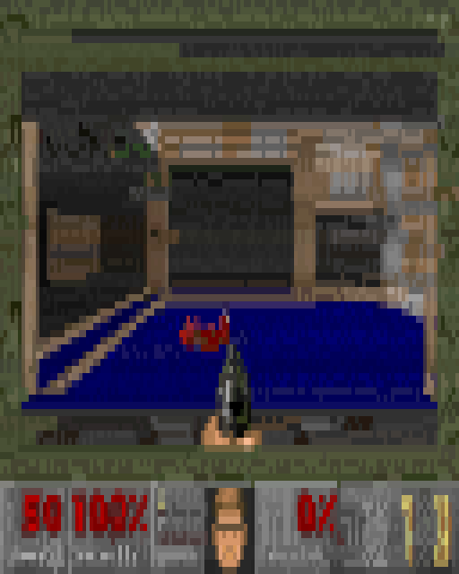

# cc-arcade

Games above the Claude Code prompt, for the minutes Claude spends working.

Run `/arcade`, pick a game, and play it right above the prompt while Claude works on your request. When Claude finishes the turn, the game pauses and its status line says so, so you never miss a reply. A pet grows alongside, fed by the tests Claude passes, the commits it makes and the files it edits. Playing costs no tokens: the plugin answers every click and command itself, without asking the model.


Nine games and a pet: snake, Tetris, 2048, Minesweeper, Flappy, Pong against the computer, a typing test, Space Invaders and Doom, the real one from 1993 (see [Doom](#doom)). Each board has one status line underneath with the score, the controls that matter now and your best score.

The plugin is built on Claude Code **function hooks**: TypeScript that runs inside Claude Code's own process, instead of shell-command hooks. They are in early access, so they need the environment variable the quick start sets, and the API can change between Claude Code releases.

## Requirements

- Claude Code 2.1.269 or later, the first build whose function hooks draw above the prompt, with `CLAUDE_CODE_ENABLE_FUNCTION_HOOKS=1` set. The quick start shows where.
- An interactive terminal session. Nothing draws in `claude -p`, the desktop app or mobile.
- A terminal that reports the mouse. One click is what gives a board the keyboard, and the picker buttons, Minesweeper, Pong and Space Invaders use the mouse too.
- A terminal font with box-drawing and block characters. Modern terminals are fine; the old Windows console draws them as boxes.
- For Doom only: `bun` or `node` on the PATH (a Claude Code installed with npm has node), and a terminal with 24-bit colour. The engine runs in a process of its own; see [Doom](#doom).

## Quick start

1. Turn function hooks on. Add this to `~/.claude/settings.json` (create the file if it does not exist, or merge the `env` key into what is there). Without it the plugin installs fine but does nothing.

   ```json
   {
     "env": {
       "CLAUDE_CODE_ENABLE_FUNCTION_HOOKS": "1"
     }
   }
   ```

   This also loads the hooks module of any other installed plugin that ships one. For a single session instead, prefix the command: `CLAUDE_CODE_ENABLE_FUNCTION_HOOKS=1 claude`.

2. Install from GitHub. The repo is its own marketplace:

   ```sh
   claude plugin marketplace add sezaakgun/cc-arcade
   claude plugin install cc-arcade@cc-arcade
   ```

3. Start `claude` and run `/arcade`. A row of buttons appears above the prompt: one per game, plus `pet`, `random`, `auto` and `close`.

   

4. Click `snake`. The board appears in place of the buttons.

5. **Click the board**, then press an arrow key. The click gives the game the keyboard; until then your keys go to the prompt.

   

6. Press **Esc** to give the keyboard back to the prompt. Click `← games` above the board to go back to the list, or `close` to close the arcade.

If `/arcade` is an unknown command, see [Troubleshooting](#troubleshooting).

To remove it:

```sh
claude plugin uninstall cc-arcade
claude plugin marketplace remove cc-arcade
```

To try it without installing, or to hack on it, clone and load it for one session:

```sh
git clone https://github.com/sezaakgun/cc-arcade
cd cc-arcade
claude --plugin-dir .
```

The repo's own `.claude/settings.json` sets the variable for sessions started inside the folder, which also loads any other installed plugin's hooks module there.

## Use

- **Pick a game**: run `/arcade` and click one, or name it directly: `/arcade tetris`.
- **Let it choose**: `/arcade random` starts any game except the pet and the one you just played. `/arcade auto` picks one for the moment; see [Auto](#auto).
- **See the games and your best scores**: `/arcade list`.
- **Back to the list**: click `← games` above the board. The picker comes back and the game you left stops.
- **Switch games**: pick another from the list, or run `/arcade <game>`. One game is open at a time.
- **Close**: click `close` above the board or in the picker, or run `/arcade stop`.

Every form of `/arcade` runs straight away, even while Claude is working.

## Games

WASD mirrors the arrows in every game that uses them.

- **`snake`**: arrows steer, Space or `p` pauses, `r` restarts. Eat the red food, keep off the walls and your own tail.
- **`tetris`**: ← → move, ↑ or `x` rotates, ↓ drops one row, Space drops to the bottom, `p` pauses, `r` restarts. The pieces fall faster every ten lines.
- **`2048`**: arrows slide every tile, `r` restarts. Equal tiles merge; the game ends when no slide changes anything.
- **`minesweeper`**: click a cell to open it, right-click to flag it. Without a mouse: arrows move the blue cursor, Space or Enter opens, `f` flags. `r` deals a new board. The first click never hits a mine.
- **`flappy`**: Space, ↑, `w`, Enter or a click flaps. `p` pauses, `r` restarts. Touching the ceiling only stops you; the floor and the pipes end the round.
- **`pong`**: ↑ ↓, or move the mouse over the board, to place your paddle on the left. Space pauses, `r` restarts. First to 5 wins.
- **`typing`**: type the line shown. Correct characters turn green; a wrong one shows on red until you backspace it. Tab skips to another line, Enter starts the next one after a finished line. Only keys the terminal delivers count, so pasting is no shortcut.
- **`invaders`**: ← → or the mouse move the ship, Space, ↑ or a click fires. `p` pauses, `r` restarts. One shot at a time, three lives, and each cleared wave starts a row lower, up to three rows, and steps faster.
- **`doom`**: the 1993 original, shareware episode, running for real. ← → turn, ↑ ↓ or `w` `s` walk, `a` `d` strafe, Shift with any of them runs. Space or a click fires, `e` opens doors and presses switches, Enter works the menus, Backspace stands in for Escape (the terminal keeps Esc for the prompt), Tab shows the automap, the digits pick weapons, and the F-keys do what they do in the game (F2 save, F3 load, F6 quick save, F9 quick load, F11 brightness). `h` cycles how the picture is drawn, `]` and `[` make it bigger and smaller, `p` pauses. Details under [Doom](#doom).

| | |
|---|---|
|  |  |
|  |  |
|  |  |

All but Doom are clones of the genre, not affiliated with or endorsed by Tetris Holding, Taito or Atari. Doom is id Software's own engine; see [Doom](#doom) for what is in it and under which terms.

## Playing while Claude works

Send your prompt, then open a game. When the turn finishes, the open game pauses and its status line turns yellow and starts with `● Claude is done`. Press a key in the game to carry on, or Esc to go and read the reply. The pet has no status line, so it shows no banner.

The board takes the rows above the prompt that Claude Code gives plugins, about half the terminal height. A taller terminal gives bigger snake, Tetris, Flappy, Pong and Invaders boards.

## Auto

`/arcade auto`, or `auto` in the picker, looks at the moment and picks from a small group:

- **The last thing Claude did was fail a test run, under five minutes ago**: `pet`, to check on it.
- **Claude has been on this turn for a minute or more**: `tetris`, `invaders`, `snake` or `doom`, something to sink into.
- **Claude is working, under a minute so far**: `flappy`, `pong` or `typing`, a quick round.
- **Claude is idle**: `2048` or `minesweeper`, games you can put down any time.

Within the group it picks at random and avoids the game you just played. The reply says why, for example `2048 (auto: Claude is idle, a game you can put down any time)`.

## The pet

`/arcade pet` shows a pet that grows with the work Claude does, in every session with the plugin loaded. You do not play it; it watches Claude's tool calls. Click it and it shows hearts.


- **A test run that passes** gives +10 XP and lifts its mood by 8. Recognised runners: `bun test`, `npm test`, `pnpm test`, `yarn test`, `pytest`, `go test`, `cargo test`, `jest`, `vitest`, `mocha`, `rspec`, `phpunit`, `make test`, and `test` tasks of `mvn`, `gradle`, `gradlew` and `sbt`, also through `npx`.
- **A test run that fails** gives +2 XP but costs 12 mood.
- **A `git commit` that succeeds** gives +15 XP and 10 mood. A `--dry-run` does not count.
- **A file edit** through Claude's `Edit`, `Write` or `NotebookEdit` gives +1 XP and 1 mood.

Level *n* needs 10·*n*² XP. The pet hatches at level 1, becomes a kid at 3, an adult at 6 and a legend at 10, and a toast marks each level. Its mood is happy from 70, okay from 35 and sad below; with no work it sinks a point every ten minutes until it is bored at 30, and only failing tests take it lower.

The pet is kept in the plugin's store, so every session feeds the same one and it survives restarts. Commands you run yourself in a terminal do not count; only Claude's tool calls do.

**What the pet sees.** To feed it, the plugin hooks every tool call in sessions where it is loaded, which means it sees each Bash command's text and whether the call failed. It matches that text against the list above and keeps counters only: no command text, file path or prompt is stored or logged. The plugin makes no network calls of any kind; the pet and your best scores stay in Claude Code's plugin store on this machine.

## Best scores

Each game keeps its best score across sessions, and a new best shows a toast. `/arcade list` shows them all.

- **snake**: most food eaten
- **tetris**: highest score, with 100, 300, 500 or 800 for clearing 1 to 4 lines at once and 2 per row dropped with Space
- **2048**: highest score when no slide is left
- **minesweeper**: fastest clear, in seconds
- **flappy**: most pipes passed
- **pong**: biggest margin you won by
- **typing**: fastest finished line, in words per minute at five characters a word
- **invaders**: highest score, 10 per alien

Doom keeps no best score here: its own tally is on the screen after each level.

## Doom

`/arcade doom` runs the actual Doom: id Software's engine as released in 1997 (`linuxdoom-1.10`), built to WebAssembly by [diekmann's port](https://github.com/diekmann/wasm-fizzbuzz/tree/main/doom), with the shareware WAD (episode one, *Knee-Deep in the Dead*) inside. That build is not in this repository: the first `/arcade doom` fetches it (6.8 MB) from the port's own site, checks it against its SHA-256 and keeps it as `doom/doom.wasm`. `CC_ARCADE_DOOM_WASM` in the environment names another file to run instead, one you built from the port yourself for instance.



A plugin's own code cannot run WebAssembly, so the engine runs in a process of its own, `doom/server.mjs`, which the plugin starts the first time you open the game, with `bun` or with `node`, whichever the PATH has. It listens on `127.0.0.1:47321` and nowhere else. Ten times a second, as often as the band may redraw, the plugin sends it the keys you pressed and gets the picture back, scaled to the board, through Claude Code's own `$.http.fetch`; nothing else crosses. A board may draw only so much at once (2000 nodes, 100000 characters, about 900 runs of colour), so the picture is drawn in strips, each a board of its own and small enough to draw every colour in it; the strips are cut from one picture, so they always agree.

- **The picture.** Four pixels a cell to start with, as the quadrant glyphs (▘▚▟ and so on) every terminal font has, in two colours a cell. `h` cycles to six a cell, the sextant glyphs of Unicode's *Symbols for Legacy Computing*, half again as much detail, which needs a terminal that draws them, as Ghostty, Kitty and WezTerm do, or a font that has them; and then to two a cell, a half block over its background, the plainest. If sextants give you boxes or blanks, press `h` again. The picture keeps the engine's shape, 1.6 times as wide as tall. It starts 32 rows tall; `]` makes it bigger and `[` smaller, four rows a step, up to what the band holds. Bigger is slower: every cell is drawn again ten times a second, and past about 5000 cells Claude Code's own drawing falls behind and the game feels sluggish. Colours a shade apart along a row are merged before drawing, which takes out most of the work and shows hardly at all. The server lifts the shadows a little for a terminal's black; `F11` in the game lifts them more, in steps, and `CC_ARCADE_DOOM_GAMMA=1` in the environment leaves them as drawn.
- **Keys.** Terminals report presses and never releases, so the server holds a movement key for a quarter of a second after each press; a key you hold repeats, and reads as held. Escape never reaches a board, so Backspace sends Doom's Escape: it opens and closes the menu. A click gives one strip of the picture the keyboard; the strips are numbered from the bottom, so shrinking the picture with `[` keeps the keyboard where you clicked unless that strip is gone, in which case click again.
- **Pausing.** The game pauses when Claude finishes a turn, when you press `p`, and after ten seconds without a key, so it waits while you type at the prompt. Any key resumes. Closing the board pauses it too; the server keeps the game for half an hour after the last request, then quits, and the next `/arcade doom` starts it afresh.
- **Terms.** The engine's source is id Software's, under the GPL 2, and the shareware WAD may be passed on whole and unchanged; both are inside the `doom.wasm` the plugin fetches, a separate program this MIT-licensed plugin talks to over HTTP, and neither is part of this repository. Doom is a trademark of id Software.

## How it works

- `hooks/register.tsx` is the hooks module. It registers `/arcade` and draws the picker or the open board above the prompt. It keeps best scores and the pet with `$.store`, times turns for `auto` on `turn.start`, pauses the open game on `turn.complete`, and feeds the pet on `tool.call`.
- `hooks/boards/*.tsx` are surface modules, one per board, mounted as `Client` elements. Each runs on the drawing thread with its own frame clock, keyboard and mouse, and posts a finished round's score back to the hooks module. `doom.tsx` is one strip of the Doom picture, mounted several times; the hooks module runs that game and hands each strip its rows.
- `hooks/games/*.ts` hold each game's rules, the pet, the best-score comparison and the `random` and `auto` pickers as pure functions. The tests cover them. For Doom the rules are the engine's; `games/doom.ts` holds how its picture becomes cells and how the terminal's keys are named for it.
- `doom/` is the Doom engine and its server: `doom.wasm`; `server.mjs`, the HTTP door on localhost that scales the picture; `engine.mjs`, the engine itself on a worker thread of the server (it blocks while it draws a screen melt, and the server must keep answering); and `launch.mjs`, which starts the server in the background so the hooks module's `$.process.run` returns.

## Troubleshooting

- **`/arcade` is an unknown command.** Function hooks are off. Check `CLAUDE_CODE_ENABLE_FUNCTION_HOOKS` is set in `~/.claude/settings.json` under `env` (see Quick start), and that the plugin is loaded with `/plugins`.
- **Keys go to the prompt instead of the game.** Click the board first. Esc hands the keyboard back to the prompt.
- **Nothing happens when you click.** Your terminal does not report the mouse. `/arcade <game>` still opens a game, but a board cannot get the keyboard without a click.
- **The board is small.** Claude Code gives the area above the prompt about half the terminal. Make the terminal taller.
- **A board is replaced by one line naming the plugin and the module.** The board threw an error or ran over its time budget and was unmounted. Run `/arcade stop` and open it again. If it repeats, start Claude with `--debug-file /tmp/cc-arcade.log` and search the log for `cc-arcade`.
- **The pet does not grow.** Only Claude's tool calls feed it, and only the commands listed in [The pet](#the-pet).
- **Games stopped working after editing the plugin.** A hot reload that fails partway leaves the old version loaded. Restart the session.
- **Doom says the game did not start.** It needs `bun` or `node` on the PATH of the shell Claude Code runs in, and the first start needs the network, to fetch the engine. `node doom/launch.mjs` (or `bun`) from the plugin folder shows what goes wrong.
- **Doom shows "the game server is not running".** The server quit after half an hour without a request, or was killed. `/arcade doom` starts it again.
- **Doom is coloured noise or boxes after `h`.** The font has no sextant glyphs. `h` again goes on to half blocks, and once more back to quadrants.
- **A strip of Doom's picture turned into one line naming the plugin and `doom.tsx`.** That strip drew more than a board may at once and was unmounted; `← games` and `/arcade doom` open the board afresh. It should not happen: each strip is cut small enough. If it does, start Claude with `--debug-file` and look for `doom.tsx` in the log.

## Limits

- The animated boards redraw ten times a second, so fast games feel coarse next to a real console. 2048 and Minesweeper are turn-based and the pet redraws five times a second.
- One game is open at a time, in about half the terminal height.
- A game only gets the keyboard after a click, and never gets Esc, which always returns to the prompt.
- A headless `claude -p` run, the desktop app and mobile never draw the arcade.
- Best scores and the pet live in the plugin's store on this machine. Nothing is shared between machines.
- Doom is the one game with a process of its own, and the one that needs a runtime installed. Its sound never plays, its picture is as tall as the band, and it takes only the keys a terminal reports: no mouse look, no Escape, no key held down longer than it repeats.

## Develop

From the repo root:

```sh
bun test                                            # game rules, the pet, best scores, random and auto
claude plugin validate .claude-plugin/plugin.json   # lists the hooked events, $ calls and surface modules
claude plugin validate .                            # checks the marketplace manifest
```

`bun test` is the only check that works on a bare clone, and CI runs it on every push. Doom's server runs by hand with `node doom/server.mjs` (or `bun`), and `python3 scripts/e2e-doom.py` drives a whole Claude Code session in a pseudo-terminal to try the board without a person; its header says what it needs. Type checking needs the early-access types: open a Claude Code session in this folder with function hooks on, run `/plugin-types` (it writes the git-ignored `.claude/types/`), then:

```sh
bunx -p typescript tsc -p .
```

Two rules for board files: never name a local variable `h`, because every JSX tag compiles to a call of `h` and a local `h` breaks the board at its first draw; and write `Client` module paths as string literals, because the engine reads them off the source.

Edits hot-reload into a running session. If a reload fails partway, the transcript says so; restart the session.

## License

MIT. See [LICENSE](LICENSE).
